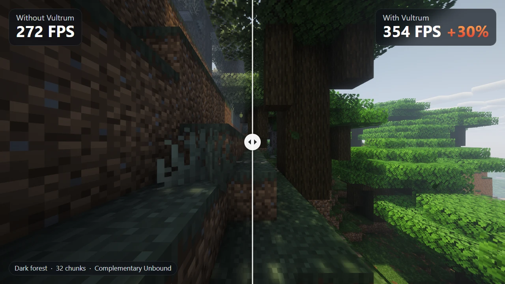
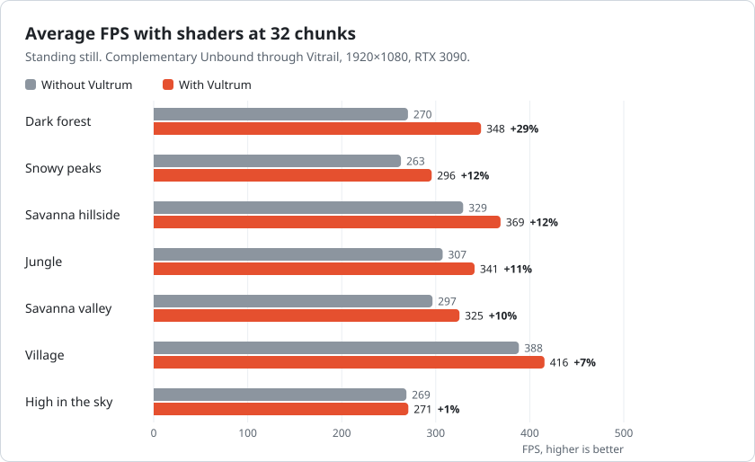
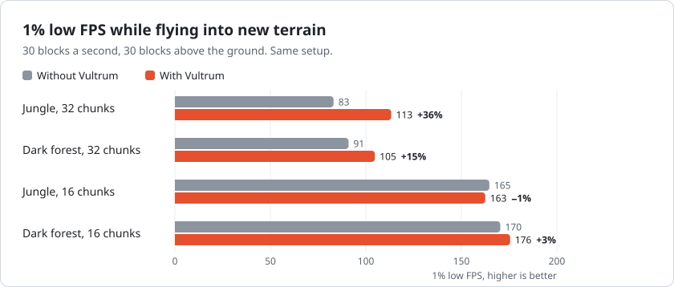

  

<h1 align="center">Vultrum</h1>

  More FPS with shader packs and smoother chunk loading for Minecraft 26.3 on Vulkan. 
  A Sodium add-on for Fabric.

  <a href="https://github.com/DebZakari/Vultrum/releases">GitHub</a> ·
  <a href="https://modrinth.com/mod/vultrum">Modrinth</a> ·
  <a href="CHANGELOG.md">Changelog</a> ·
  <a href="#install">Install</a> ·
  <a href="#settings">Settings</a> ·
  <a href="#compatibility">Compatibility</a> ·
  <a href="https://github.com/DebZakari/Vultrum/issues">Report a bug</a>

  
   
  Left without Vultrum, right with it. The same picture, more frames.

> [!NOTE]
> Vultrum is in alpha. Version 0.1.0-alpha.3 has been tested on one PC: Windows 11, an NVIDIA RTX 3090 and a Ryzen 5 5600X. If something breaks or looks wrong, please [open an issue](https://github.com/DebZakari/Vultrum/issues) and say which GPU you have.

## What it does

Minecraft 26.3 can draw with Vulkan instead of OpenGL. Vultrum adds two things on top of Sodium there.

**With a Vitrail shader pack**, it works out on the GPU, every frame, which terrain is hidden behind hills, trees and buildings, and skips drawing it. It also leaves block faces out of the shadow map when they can't change a shadow. Dense scenes gain the most: 29% more FPS in a dark forest at render distance 32. Terrain and shadows look the same.

**With or without shaders**, it smooths out chunk loading. Sodium does some of its loading work in bursts: a pile of new chunks from the server, the chunks that leave your view, the cleanup after Java's garbage collector runs. Vultrum spreads that work over several frames, so flying into new terrain stutters less. Alpha.3 also spreads already-loaded terrain registration across frames after F3+A or a render distance change, reducing reload freezes.

Most features are on by default and can be turned off in Sodium's video settings. Skip Sunless Terrain is off by default.

Inspired by [Nvidium](https://github.com/MCRcortex/nvidium) and [Vercidium's voxel optimisation work](https://vercidium.com/blog/voxel-world-optimisations/).

## Performance

In alpha.3, median peak frames during repeated terrain reloads at 32 chunks were 27–47% shorter across three comparisons on the RTX 3090. A longer comparison confirmed the improvement. Average FPS stayed essentially unchanged; the change reduces reload freezes. The FPS charts and flight results below were measured with alpha.1.

<picture>
  <source media="(prefers-color-scheme: dark)" srcset="docs/images/fps-dark.svg">
  
</picture>

<picture>
  <source media="(prefers-color-scheme: dark)" srcset="docs/images/flight-dark.svg">
  
</picture>

Complementary Unbound through Vitrail, 1920×1080 fullscreen, RTX 3090 and Ryzen 5 5600X, measured with Vultrum 0.1.0-alpha.1. "Without Vultrum" is the same game with all of Vultrum's settings off, which is plain Sodium and Vitrail. Every number is the mean of two runs of the benchmark in this repository ([`tools/bench.ps1`](tools/bench.ps1)).

How much you gain depends on how much of the view is hidden. In a dark forest most of the terrain behind the first trees never gets drawn. High in the sky almost nothing is hidden, so the culling switches itself off and FPS stays where it was. At 16 chunks there's less to hide, and the gains are smaller (0 to 11%).

While flying at 32 chunks, the slowest 1% of frames got 15 to 36% faster, and the longest frame in the jungle went from 18.9 ms to 11.3 ms. At 16 chunks the difference was within the noise between runs.

Vitrail in these runs was [Vultrum's build of Vitrail](https://github.com/DebZakari/vitrail-shaders/releases/tag/0.12.0-beta.vultrum.3), which has a few speedups that Vitrail's own release doesn't have yet. With Vitrail from Modrinth, FPS will be somewhat lower overall.

All numbers

Standing still, 5 seconds per scene:

| Scene | Render distance | FPS without | FPS with | Change | 1% low without | 1% low with |
|---|---:|---:|---:|---:|---:|---:|
| Dark forest | 32 | 270 | 348 | +29% | 237 | 293 |
| Snowy peaks | 32 | 263 | 296 | +12% | 234 | 260 |
| Savanna hillside | 32 | 329 | 369 | +12% | 286 | 311 |
| Jungle | 32 | 307 | 341 | +11% | 269 | 292 |
| Savanna valley | 32 | 297 | 325 | +10% | 260 | 281 |
| Village | 32 | 388 | 416 | +7% | 323 | 316 |
| High in the sky | 32 | 269 | 271 | +1% | 238 | 239 |
| Dark forest | 16 | 322 | 357 | +11% | 273 | 303 |
| Snowy peaks | 16 | 342 | 356 | +4% | 277 | 298 |
| Savanna hillside | 16 | 356 | 382 | +7% | 296 | 314 |
| Jungle | 16 | 321 | 342 | +6% | 276 | 292 |
| Savanna valley | 16 | 337 | 350 | +4% | 260 | 271 |
| Village | 16 | 404 | 420 | +4% | 330 | 348 |
| High in the sky | 16 | 384 | 383 | 0% | 323 | 322 |

Flying straight ahead into terrain the game hasn't loaded yet:

| Flight | Render distance | FPS without | FPS with | 1% low without | 1% low with | 0.1% low without | 0.1% low with | Longest frame without | Longest frame with |
|---|---:|---:|---:|---:|---:|---:|---:|---:|---:|
| Jungle | 32 | 235 | 245 | 83 | 113 | 64 | 96 | 18.9 ms | 11.3 ms |
| Dark forest | 32 | 197 | 213 | 91 | 105 | 71 | 88 | 14.7 ms | 12.2 ms |
| Jungle | 16 | 332 | 337 | 165 | 163 | 123 | 117 | 10.4 ms | 12.1 ms |
| Dark forest | 16 | 298 | 307 | 170 | 176 | 140 | 151 | 8.3 ms | 6.7 ms |

## Install

You need a Fabric instance for Minecraft 26.3 on Java 25, with these mods:

| Mod | Version | |
|---|---|---|
| [Sodium](https://modrinth.com/mod/sodium) | 0.9.3-alpha.1 or later | required. 0.9.2 won't load with Vultrum |
| [Fabric API](https://modrinth.com/mod/fabric-api) | 0.162.0+26.3 or later | required by Sodium |
| [Vitrail Shaders](https://modrinth.com/mod/vitrail-shaders) | 0.12 | optional, for shader packs on Vulkan and for Vultrum's culling |
| Vultrum | 0.1.0-alpha.3 | from [GitHub Releases](https://github.com/DebZakari/Vultrum/releases) or [Modrinth](https://modrinth.com/mod/vultrum) |

Fabric Loader 0.19.5 or later.

For shader packs you can use Vitrail from Modrinth, or [Vultrum's build of Vitrail](https://github.com/DebZakari/vitrail-shaders/releases/tag/0.12.0-beta.vultrum.3). It's the build Vultrum is tested with: Vitrail 0.12.0-beta, plus fixes for block-breaking cracks and player names hidden by terrain under a shader pack, and faster drawing of mobs and chests. It replaces Vitrail in your `mods` folder. If something goes wrong with it, report it on [Vultrum's issues](https://github.com/DebZakari/Vultrum/issues), not Vitrail's.

What changed in each version is in the [changelog](CHANGELOG.md).

Then switch the game to Vulkan: **Options → Video Settings → Graphics API → Prefer Vulkan (Experimental)**, and restart. The game's default is OpenGL. Vultrum's loading fixes still work there, but its culling doesn't.

## Settings

Vultrum adds two pages to Sodium's video settings, **Culling** and **Loading**. A change is saved right away and applies the next time you start the game. Each setting's tooltip says what it does and what it was measured to do.

**Culling** needs Vitrail and is greyed out without it. These settings only do something while a shader pack is on, and GPU Occlusion Culling only if a pack was on when the game started.

| Setting | Default | |
|---|---|---|
| GPU Occlusion Culling | on | Skips terrain hidden behind other terrain. It turns itself off in open scenes, where it would cost more than it saves. |
| Light-Facing Shadow Faces | on | Draws only the sides of solid blocks that face the sun or moon into the shadow map. |
| Skip Sunless Terrain | off | Leaves terrain that sunlight can't reach, such as caves, out of the shadow map. About 1% more FPS. |

GPU Occlusion Culling falls back to ordinary terrain drawing when the device is unsupported or its cull fails. The log reports whether the setting was requested, whether it is active, and why it is off. A shader pack must be enabled and its saved launch state readable when the game starts; enabling it later needs a restart.

**Loading** needs only Sodium, and works without shaders.

| Setting | Default | |
|---|---|---|
| Spread Chunk Arrivals | on | Handles at most 1 ms of the server's packets a frame, so a burst of new chunks is spread out. |
| Smaller Terrain Buffers | on | Caps each new terrain buffer at 96 MiB. A bigger one stalled the GPU for up to 5 ms. Uses up to 0.6 GB more video memory when flying fast at 32 chunks. |
| Spread Chunk Unloads | on | Removes about 0.25 ms worth of chunks a frame instead of all of them at once. |
| Spread Terrain Reloads | on | Registers about 2 ms of already-loaded terrain columns a frame after F3+A or a render distance change. Terrain reappears over several frames while the reload completes. |
| Background Buffer Cleanup | on | Moves Sodium's buffer cleanup to its own thread. After a garbage collection it could take up to 33 ms of one frame. |

## Compatibility

Vultrum is client-side. It works in singleplayer and on servers, and the server doesn't need it.

GPU occlusion culling automatically adapts to the GPU's compute limits, including devices without subgroup arithmetic or with 128-thread workgroups. Both compute paths have been checked on the RTX 3090; AMD and Intel hardware remain untested.

Tested on Vulkan together with Vitrail and Complementary Unbound, all in one instance, with no errors from Vultrum:

- **Performance mods:** Lithium, FerriteCore, ImmediatelyFast, Entity Culling, More Culling, C2ME, ScalableLux, Distant Horizons, Sodium Extra, Bobby, Dynamic FPS, BadOptimizations, Krypton, Debugify, Particle Core, FastQuit and Language Reload.
- **Other popular mods:** Xaero's Minimap and World Map, JourneyMap, AppleSkin, Zoomify, Mod Menu, YACL, Cloth Config, ViaFabricPlus, LambDynamicLights, Continuity, Entity Model Features, Entity Texture Features, 3D Skin Layers, Not Enough Animations, First-person Model, JEI, Jade, Litematica, Freecam, Mouse Tweaks, Inventory Profiles Next, Controlling, Chat Heads, Shulker Box Tooltip, Wavey Capes, Sound Physics Remastered, Presence Footsteps, BetterF3 and Visuality.

Doesn't work with:

- **Nvidium** and **Reese's Sodium Options.** Both need Sodium 0.9.2, so the game won't start with them and Vultrum. Nvidium is also OpenGL only.
- **Iris shaders.** Iris switches itself off on Vulkan, so its packs need OpenGL. It loads next to Vultrum without problems, it just won't draw a pack. Use Vitrail for shader packs on Vulkan.
- **Distant Horizons with Iris** on Vulkan. Distant Horizons picks OpenGL when Iris is installed and stops the game with a dialog. With Vitrail instead of Iris it works.
- Other mods that only render with OpenGL.

## FAQ

**Do I need a shader pack?**
No. Without one, the loading fixes still work. The culling only runs under a Vitrail shader pack, because that's where terrain costs the most to draw.

**Will it work on my AMD or Intel GPU?**
It hasn't been tested on them yet. Vultrum uses plain Vulkan features, nothing NVIDIA-only. If you try it, please open an issue and say how it went, good or bad.

**Is it like Nvidium?**
Similar goal. Nvidium needs an NVIDIA GPU and OpenGL. Vultrum runs on Minecraft's Vulkan renderer and isn't tied to one GPU brand.

**Can I put it in a modpack?**
Yes. See the licence below.

## Reporting bugs

Open an issue with:

- what happened, and a screenshot if it's visual (with the place, the time of day and your render distance),
- your GPU and driver version,
- `logs/latest.log` and your mod list.

## Building

`./gradlew build` with JDK 25. The jar ends up in `build/libs/`.

## Licence

Vultrum is licensed under the [GNU LGPL 3.0](LICENSE). You can use it in modpacks and other projects. If you change Vultrum itself and share the result, share your changes under the same licence.
